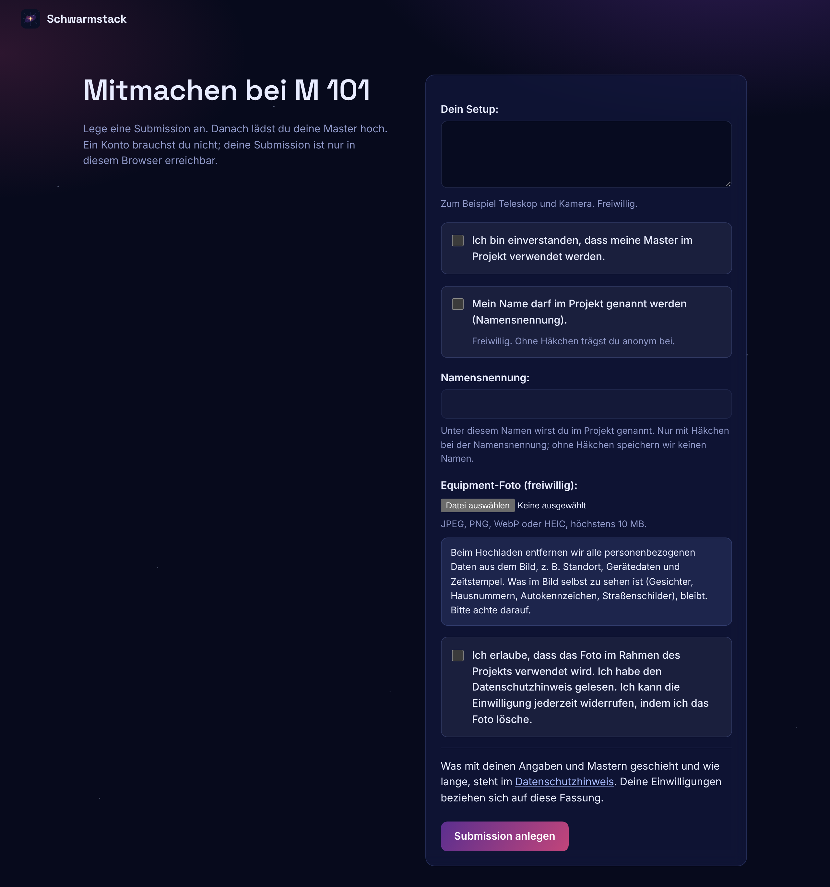

<picture>
  <source media="(prefers-color-scheme: dark)" srcset="brand/schwarmstack-logo-dark-bg.svg">
  
</picture>

# Schwarmstack

An upload service for community astrophotography projects: many participants shoot the same object and upload their finished masters (XISF or FITS, 32-bit). The operators combine them into one image. Participants need no account.

**Status:** version 0.x, ahead of the first public release (v0.2.0). Schwarmstack is built for a project of the DZVF community (a German astrophotography group). You can run it for your own project, but there is no support promise, and until 1.0 things may change between versions; the changelog says what. The interface and most of the documentation are in German.



## What it does

- Participation without an account, uploads of large files in parts, straight into S3-compatible storage (not through the app server), with pause and resume.
- Every master is checked on arrival (format, 32-bit float, planes for the channel, complete, size, duplicate). A rejected file gets a reason.
- Optional credit by name, revocable at any time; an optional equipment photo with its metadata stripped.
- For operators: one campaign per installation, quotas, an admin with statistics, export manifest and download list, deletion period after the final export.

## Try it

Needs [uv](https://docs.astral.sh/uv/) and Python 3.12 or newer. No Docker and no S3; masters go to a local folder:

```bash
git clone https://github.com/northalpha/schwarmstack.git
cd schwarmstack
uv sync
cd src
export DEBUG=1
uv run python manage.py migrate
uv run python manage.py campaign --object "M 101" \
  --starts-at 2026-01-01T00:00+01:00 --ends-at 2027-12-31T23:59+01:00 \
  --quota-gib 2 --global-cap-gib 400
uv run python manage.py createsuperuser
uv run python manage.py runserver
```

The participation page is then at <http://localhost:8000/>, the admin at <http://localhost:8000/betrieb/>. `DEBUG=1` is for trying it out only.

## Running it yourself

A single Compose setup with app, Caddy (TLS) and S3-compatible storage (Garage), set up by a script, is planned (see [ADR 0011](docs/adr/0011-release-und-selbstbetrieb.md), in German). Until then, [`docs/betrieb/deployment.md`](docs/betrieb/deployment.md) describes how the DZVF operators deploy it.

The bundled privacy notice is written for the DZVF project. Anyone running Schwarmstack needs their own notice and is responsible for it. This is not legal advice.

## Contributing and security

Issues are welcome. Please discuss in an issue before opening a pull request. Report vulnerabilities privately through GitHub ("Report a vulnerability" under *Security*), not as a public issue.

## License

[MIT](LICENSE). The bundled Uppy build keeps its own license.
