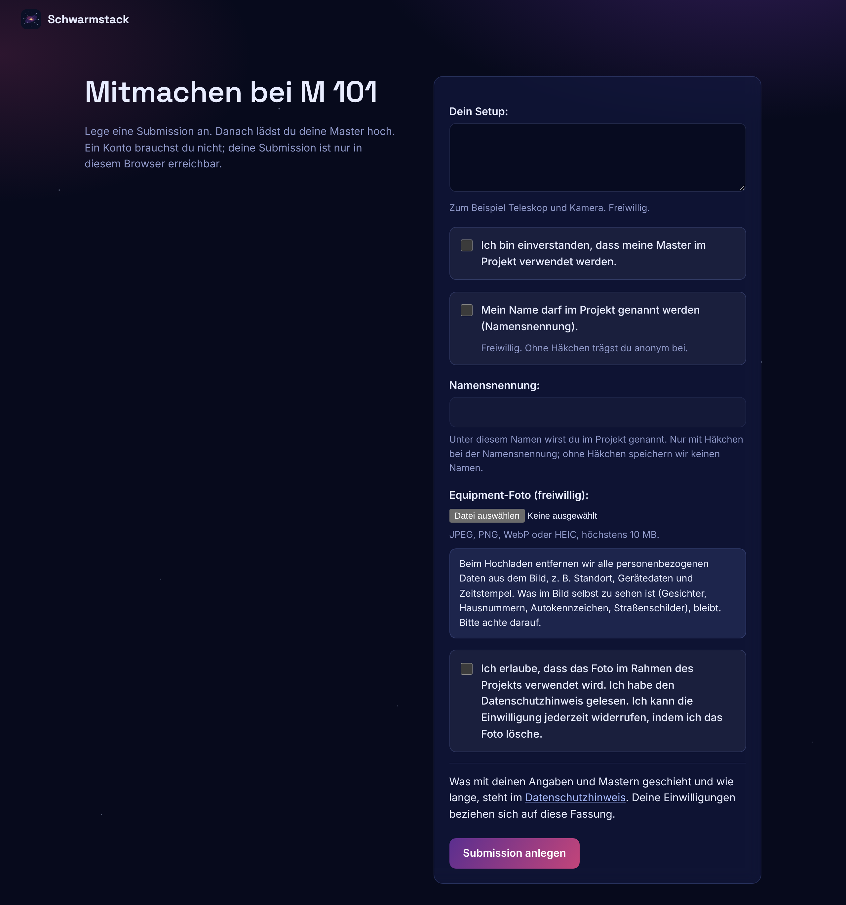
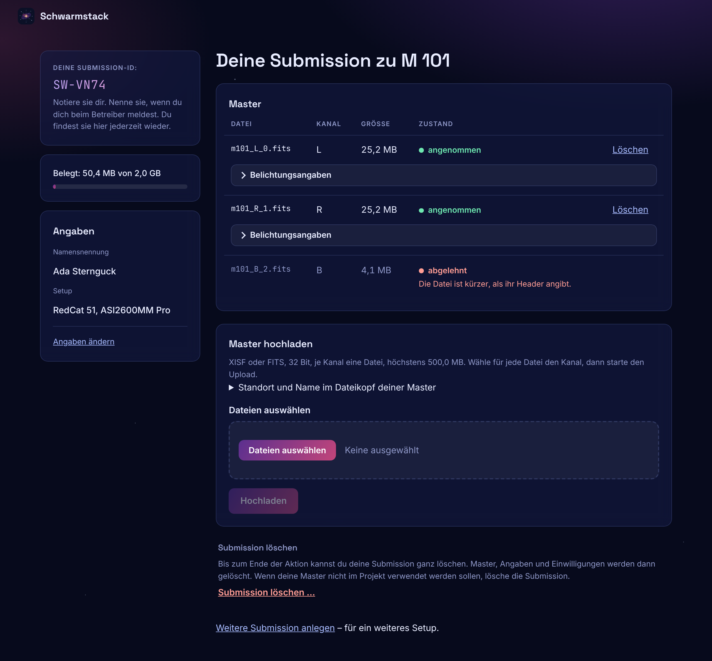
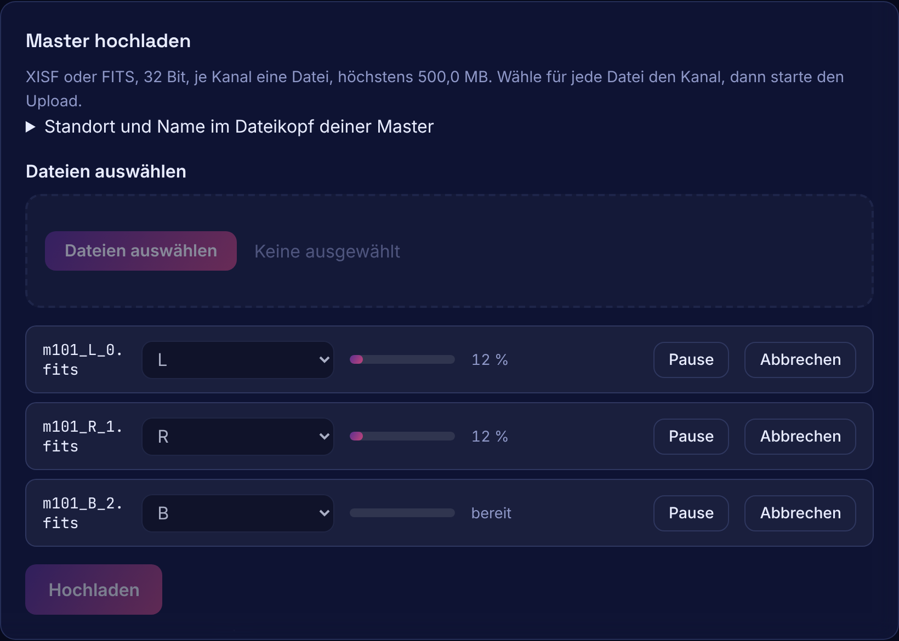
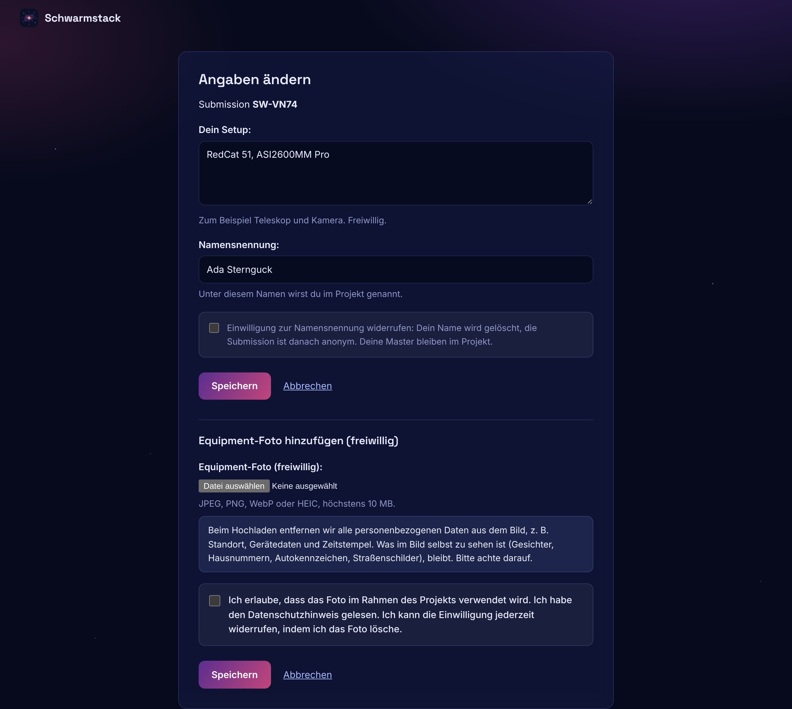
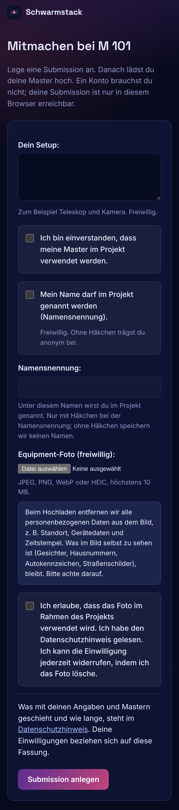
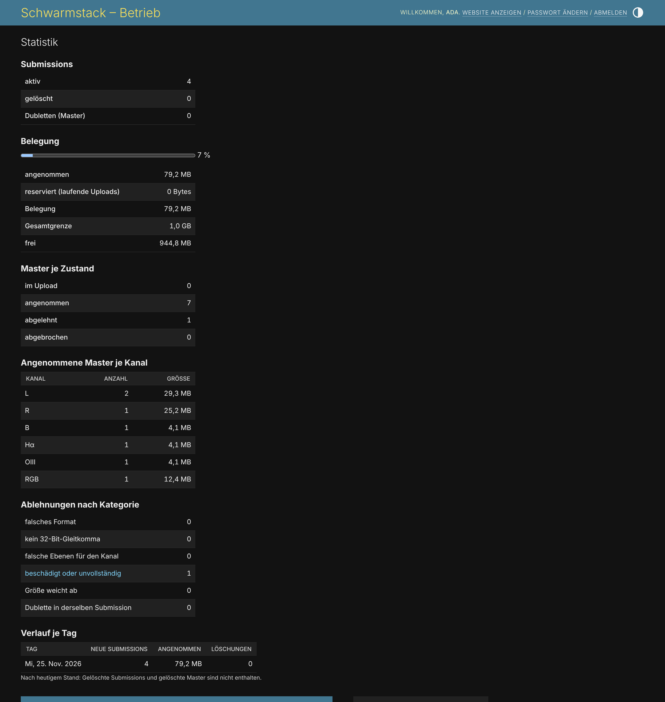

<picture>
  <source media="(prefers-color-scheme: dark)" srcset="brand/schwarmstack-logo-dark-bg.svg">
  
</picture>

# Schwarmstack

Upload-Dienst für Gemeinschaftsprojekte in der Astrofotografie: Viele Teilnehmende fotografieren dasselbe Objekt und laden ihre fertig integrierten Master (XISF oder FITS, 32 Bit) hoch. Die Betreiber führen sie zu einem Bild zusammen. Teilnehmende brauchen dafür kein Konto.

[](LICENSE)
[](https://github.com/northalpha/schwarmstack/actions/workflows/ci.yml)

**Stand:** Version 0.x, vor dem ersten öffentlichen Release (v0.2.0). Schwarmstack ist für die Aktion der [DZVF-Community](https://community.example.com) gebaut. Wer es für eine eigene Aktion betreiben will, kann das, bekommt aber keine Support-Zusage, und bis 1.0 kann sich zwischen zwei Versionen noch etwas ändern. Der Changelog sagt dann, was.

*English in short: see [README.en.md](README.en.md).*

<picture>
  <source media="(prefers-color-scheme: light)" srcset="docs/bilder/teilnahme-hell.png">
  
</picture>

## Was es kann

**Für Teilnehmende**

- Mitmachen ohne Konto: Die Submission ist nur im eigenen Browser erreichbar, eine Submission-ID dient als Beleg.
- Master direkt in den Objektspeicher hochladen, auch große Dateien in Teilen, mit Pause, Fortsetzen nach Neuladen und Fortschrittsanzeige.
- Sofortige Prüfung jedes Masters: Format, 32-Bit-Gleitkomma, Ebenen passend zum Kanal, vollständig, Größe, Dublette. Eine abgelehnte Datei nennt den Grund.
- Belichtungsangaben werden aus dem Dateikopf vorgeschlagen und nur auf Klick übernommen.
- Namensnennung ist freiwillig und jederzeit widerrufbar. Optional ein Equipment-Foto, dessen Metadaten beim Hochladen entfernt werden.
- Angaben ändern und die ganze Submission löschen, solange die Aktion läuft.

**Für Betreiber**

- Eine Aktion je Installation, mit Quote je Submission, Gesamtgrenze, Nachfrist und Höchstgröße je Master.
- Admin mit Statistik (Belegung, Master je Zustand und Kanal, Ablehnungen, Verlauf je Tag), Anmeldung mit Bremse gegen Durchprobieren.
- Export als Manifest und Download-Liste (`aria2c`), Löschfrist und Abbau nach dem endgültigen Export.
- Öffentliche Community-Zahlen als `/zahlen.json`, Betriebsmeldungen per Mail.

## Bilder

| Prüfergebnis | Upload läuft |
|---|---|
|  |  |

| Angaben ändern | Auf dem Handy |
|---|---|
|  |  |

<picture>
  <source media="(prefers-color-scheme: light)" srcset="docs/bilder/statistik-hell.png">
  
</picture>

Die Bilder zeigen Demo-Daten und entstehen reproduzierbar mit `uv run python scripts/screenshots.py`.

## Ausprobieren

Voraussetzung: [uv](https://docs.astral.sh/uv/) und Python 3.12 oder neuer. Ohne Docker und ohne S3, die Master landen in einem lokalen Ordner:

```bash
git clone https://github.com/northalpha/schwarmstack.git
cd schwarmstack
uv sync
cd src
export DEBUG=1
uv run python manage.py migrate
uv run python manage.py campaign --object "M 101" \
  --starts-at 2026-01-01T00:00+01:00 --ends-at 2027-12-31T23:59+01:00 \
  --quota-gib 2 --global-cap-gib 400
uv run python manage.py createsuperuser   # für den Admin unter /betrieb/
uv run python manage.py runserver
```

Danach ist die Teilnahmeseite unter <http://localhost:8000/> erreichbar, der Admin unter <http://localhost:8000/betrieb/>. `DEBUG=1` ist nur zum Ausprobieren gedacht.

## Self-Hosting

Ein Skript richtet App, Caddy (TLS) und S3-kompatiblen Speicher (Garage) mit Docker Compose ein: `deploy/self-hosting/setup.sh`, beschrieben in [`docs/betrieb/self-hosting.md`](docs/betrieb/self-hosting.md) ([ADR 0011](docs/adr/0011-release-und-selbstbetrieb.md)). Zum Ausprobieren mit Docker, auch auf dem Mac mit Apple Silicon, startet `./setup.sh --lokal` alles auf `localhost` ohne Zertifikat. Wie die Betreiber der DZVF-Aktion ausrollen (GitHub Actions, eigener S3-Speicher), steht in [`docs/betrieb/deployment.md`](docs/betrieb/deployment.md).

Wichtig für jeden Betreiber: Der mitgelieferte Datenschutzhinweis ist auf die DZVF-Aktion zugeschnitten. Wer Schwarmstack selbst hostet, braucht einen eigenen Hinweis und ist selbst dafür verantwortlich. Das hier ist keine Rechtsberatung.

## Wie es gebaut ist

- **Stack:** Django 5.2 (LTS) mit gunicorn und WhiteNoise, SQLite, Objektspeicher über die S3-Schnittstelle (`boto3`), Caddy als Proxy, im Browser Uppy für den Multipart-Upload.
- **Dateien bleiben unverändert:** Die Master werden nie entpackt oder umgeschrieben, die Prüfung liest nur den Dateikopf ([ADR 0003](docs/adr/0003-dateien-unveraendert-ohne-packen.md)). Der Browser lädt direkt in den Speicher hoch, nicht über den App-Server ([ADR 0005](docs/adr/0005-direkter-upload-in-den-s3-speicher.md)).
- **Wegweiser:** [`GLOSSARY.md`](GLOSSARY.md) erklärt die Begriffe (Aktion, Submission, Master, Kanal, Export …), [`docs/adr/`](docs/adr/) hält schwer umkehrbare Entscheidungen fest, [`docs/betrieb/`](docs/betrieb/) beschreibt den Betrieb, [`CODING_STANDARDS.md`](CODING_STANDARDS.md) das, was das Review beurteilt, [`changelog.d/`](changelog.d/README.md) die Änderungen bis zum nächsten Release.
- **Prüfen wie in der CI:** `scripts/pruefen.sh` startet Garage (S3) und lässt Lint, Migrationen und alle Tests laufen, auch den E2E-Test im Browser. `scripts/pruefen.sh --schnell` geht ohne Garage. Einzelne Tests: `uv run pytest` im Wurzelverzeichnis, siehe [`docs/betrieb/s3-speicher.md`](docs/betrieb/s3-speicher.md).
- **Gebaut mit Coding-Agenten:** Ein großer Teil des Codes entsteht in Sitzungen mit Claude Code, Ticket für Ticket und testgetrieben, mit Review durch die Betreiber vor jedem Merge. Die Regeln dafür stehen in [`CLAUDE.md`](CLAUDE.md) und [`docs/agents/`](docs/agents/).

## Mitmachen

Issues sind willkommen: Fehler, Wünsche und Fragen, die Formulare führen durch. Pull Requests bitte erst nach Absprache in einem Issue, damit niemand Arbeit umsonst macht. Es gibt kein Support-Versprechen. Alles Weitere steht in [`CONTRIBUTING.md`](CONTRIBUTING.md) und im [Verhaltenskodex](CODE_OF_CONDUCT.md). Sicherheitslücken bitte nicht als öffentliches Issue melden, sondern wie in [`SECURITY.md`](SECURITY.md) beschrieben.

## Lizenz

[MIT](LICENSE). Mitgelieferter fremder Code (das Uppy-Bundle) steht mit seinen Lizenzen in [`THIRD_PARTY.md`](THIRD_PARTY.md).
